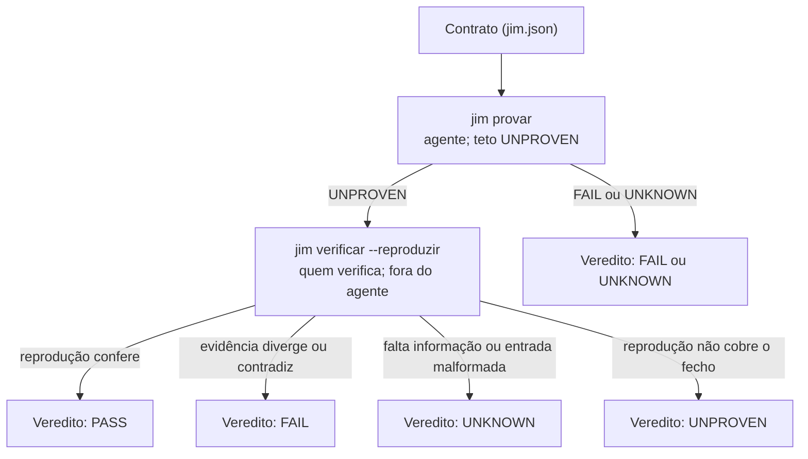

# Jim


O loop obriga o agente a **provar**: ele registra a evidência, mas não aprova o próprio trabalho.
**PASS** só sai quando quem verifica reproduz a execução fora do agente.
Sem reprodução, o teto é **UNPROVEN**.

## Vereditos

| Veredito | Código de saída | Significado |
|---|---|---|
| PASS | 0 | O gate passa sobre evidência íntegra e a reprodução fora do agente confere. |
| FAIL | 1 | A evidência contradiz o critério ou algo diverge. |
| UNKNOWN | 2 | Falta informação ou a entrada está malformada. |
| UNPROVEN | 3 | O gate passaria, mas a reprodução falta ou não cobre o fecho. |
| (erro, sem veredito) | 4 | Erro de uso, entrada ou I/O, função não implementada ou falha interna. |

## Instalação

Veja os [requisitos](#requisitos) abaixo. Em resumo: CPython ≥ 3.9, Rust ≥ 1.85 e rede.

```sh
uvx --from git+https://github.com/XAKCN/Jim jim --version
```

O comando imprime `jim 0.1.0`. Como alternativa, instale com o pip:

```sh
pip install git+https://github.com/XAKCN/Jim
```

## Requisitos

| Item | Valor | Fonte |
|---|---|---|
| Python | CPython ≥ 3.9 (CI testa 3.9 e 3.13) | `pyproject.toml` (`requires-python`), CI |
| Dependências de runtime | nenhuma | `pyproject.toml` (`dependencies = []`) |
| Rust / cargo | ≥ 1.85 (edition 2021), necessário para compilar o núcleo | `Cargo.toml` (`rust-version`) |
| Build | maturin ≥ 1.9, < 2; o pip/uv baixa sozinho | `pyproject.toml` (`build-system`) |
| uv / uvx | opcional; só para o comando de uma linha | — |
| Sistema | Linux (CI em Ubuntu 24.04). macOS e Windows ainda não: a leitura segura do inventário recusa com `J-C7` | CI, `src/hash.rs` |
| Rede | necessária para instalar via git (clona o repo e baixa crates e o maturin) | — |

Não há wheel pré-compilado nem pacote publicado no PyPI: toda instalação compila o núcleo Rust
na máquina. Para desenvolver, `pip install -r requirements.txt` instala só o maturin.

## Como funciona




O contrato define arquivos, critérios, instrumentos Python e saídas esperadas.
O núcleo Rust valida os dados de decisão e decide o veredito.
O Python orquestra arquivos e subprocessos e nunca decide; a CLI mapeia o veredito para o código de saída.
Quem verifica usa o próprio contrato de confiança. Os instrumentos rodam com as permissões do usuário: execute só os confiáveis.

## Demo: falso PASS pego ao vivo

Em um clone do repositório, com o Jim instalado pelo pip no ambiente ativo:

```sh
python -B demo/rodar.py
```

```text
FALSO PASS alegado pelo instrumento (exit 0): {"dobro": 4}
Jim recusou (exit 2): R-2.9: campo adequado omitido
FALSO PASS tautológico (exit 0 com código correto e quebrado): {"passou": true}
Jim recusou (FAIL, exit 1): o teste aprovou o código quebrado (R-2.10: adequado deve ser True, registrado False)
Candidato honesto, provar (exit 3): UNPROVEN
Verificar --reproduzir (exit 0): PASS
```

1. Alegação sem prova: a sonda imprime um resultado fixo, o controle negativo não a derruba e sai UNKNOWN.
2. Teste tautológico: aprova também o código quebrado; o controle negativo expõe isso e sai FAIL.
3. Candidato honesto: `provar` dá UNPROVEN; PASS só vem depois, com `verificar --reproduzir`.

## Uso num chatbot comum

Cole o prompt abaixo em um chat com qualquer LLM. No chat ele é só uma instrução: não executa nem impõe nada.

```text
gauntlet
1. Contrato primeiro: defina critérios e instrumento de teste antes de construir.
2. Nunca diga "pronto" sem prova reproduzível.
3. Todo teste tem controle negativo: ele precisa falhar com o código quebrado.
4. Todo veredito é um de: PASS, FAIL, UNPROVEN ou UNKNOWN.
5. Sem execução real, o teto é UNPROVEN. PASS exige reprodução fora do agente.
6. Com terminal, use `uvx --from git+https://github.com/XAKCN/Jim jim` no lugar de `jim`.
7. Você roda `jim provar`; quem verifica roda `jim verificar --reproduzir` fora do agente.
8. Feche com uma tabela: afirmação | evidência | veredito.
Confirme a ativação respondendo apenas "gauntlet armado".
```

Depois siga o roteiro:

1. Ative com a palavra `gauntlet` e espere a resposta `gauntlet armado`.
2. Feche o contrato (critérios e instrumento) antes de pedir a construção.
3. Peça a prova reproduzível e o controle negativo de cada teste.
4. Com terminal, o agente roda `uvx --from git+https://github.com/XAKCN/Jim jim provar`.
5. Fora do agente, rode `uvx --from git+https://github.com/XAKCN/Jim jim verificar --reproduzir`.
6. Cobre a tabela final: afirmação | evidência | veredito.

## Chatbot sem rede (Claude.ai, ChatGPT)

Sem terminal nem rede, o chat não executa nada, e o teto é UNPROVEN. Isso é o comportamento
esperado, não falha. Para usar assim, anexe o zip do repositório ou cole o
[AGENTS.md](https://raw.githubusercontent.com/XAKCN/Jim/main/AGENTS.md) (link raw) junto com o
prompt acima. Para chegar a PASS, use um agente com terminal (Claude Code, Codex, Cursor), que
roda `jim provar`, e reproduza com `jim verificar --reproduzir` fora do agente.

## Links

- [AGENTS.md](AGENTS.md): instruções para agentes de código.
- [CONTRATO.md](CONTRATO.md) e [contract/](contract/): semântica, formatos e CLI.
- Licença [MIT](LICENSE). Autor: XAKCN.
