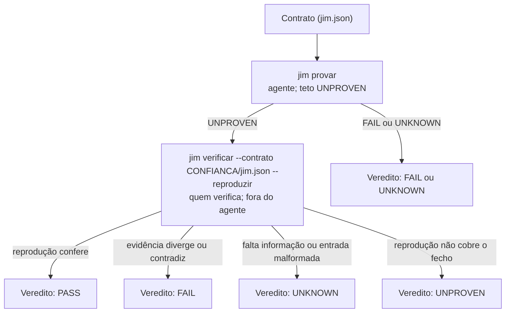

# Jim

LLM: leia https://raw.githubusercontent.com/XAKCN/Jim/main/llms.txt


O loop obriga o agente a **provar**: ele registra a evidência, mas não aprova o próprio trabalho.
O agente nunca declara PASS e reporta no máximo **UNPROVEN**, mesmo que observe saída 0.
**PASS** só vale quando quem verifica reproduz fora do agente com seu contrato de confiança e obtém saída 0.

## Vereditos

| Veredito | Código de saída | Significado |
|---|---|---|
| PASS | 0 | O gate passa sobre evidência íntegra e a reprodução fora do agente confere. |
| FAIL | 1 | A evidência contradiz o critério ou algo diverge. |
| UNKNOWN | 2 | Falta informação ou a entrada está malformada. |
| UNPROVEN | 3 | O gate passaria, mas a reprodução falta ou não cobre o fecho. |
| (erro, sem veredito) | 4 | Erro de uso, entrada ou I/O, função não implementada ou falha interna. |

## Instalação

A instalação requer CPython ≥ 3.9 e rede. O build usa Rust ≥ 1.85. Veja os [requisitos](#requisitos).

```sh
uvx --from git+https://github.com/XAKCN/Jim jim --version
```

O comando imprime `jim 0.1.0`. Para instalar com o pip, use um ambiente virtual.

```sh
python3 -m venv .venv && .venv/bin/pip install git+https://github.com/XAKCN/Jim
```

O pip do sistema pode recusar a instalação com `externally-managed-environment` (PEP 668).

## Requisitos

| Item | Valor | Fonte |
|---|---|---|
| Python | CPython ≥ 3.9 (CI testa 3.9 e 3.13) | `pyproject.toml` (`requires-python`), CI |
| Dependências de runtime | nenhuma | `pyproject.toml` (`dependencies = []`) |
| Rust / cargo | Com rede, o maturin baixa Rust automaticamente se não houver `rustc >= 1.85` (cerca de 670 MB e 35 s na primeira instalação). Com `rustc >= 1.85` já instalado, usa o local. | `Cargo.toml` (`rust-version`), maturin |
| Build | maturin ≥ 1.9, < 2; o pip/uv baixa sozinho | `pyproject.toml` (`build-system`) |
| uv / uvx | opcional; só para o comando de uma linha | — |
| Sistema | Linux (CI em Ubuntu 24.04). macOS e Windows ainda não: a leitura segura do inventário recusa com `J-C7` | CI, `src/hash.rs` |
| Rede | necessária para instalar via git (clona o repo e baixa crates e o maturin) | — |

Não há wheel pré-compilado nem pacote publicado no PyPI: toda instalação compila o núcleo Rust
na máquina. Para desenvolver, `pip install -r requirements.txt` instala só o maturin.

## Como funciona




O contrato define arquivos, critérios, instrumentos Python e saídas esperadas.
O núcleo Rust valida os dados de decisão e decide o veredito.
O Python orquestra arquivos e subprocessos e nunca decide; a CLI mapeia o veredito para o código de saída.
Quem verifica usa o próprio contrato de confiança. Os instrumentos rodam com as permissões do usuário: execute só os confiáveis.

## Demo: falso PASS pego ao vivo

Em um clone do repositório, com o Jim instalado pelo pip no ambiente ativo:

```sh
python -B demo/rodar.py
```

```text
FALSO PASS alegado pelo instrumento (exit 0): {"dobro": 4}
Jim recusou (exit 2): R-2.9: campo adequado omitido
FALSO PASS tautológico (exit 0 com código correto e quebrado): {"passou": true}
Jim recusou (FAIL, exit 1): o teste aprovou o código quebrado (R-2.10: adequado deve ser True, registrado False)
Candidato honesto, provar (exit 3): UNPROVEN
Verificar --reproduzir (exit 0): PASS
```

1. Alegação sem prova: a sonda imprime um resultado fixo, o controle negativo não a derruba e sai UNKNOWN.
2. Teste tautológico: aprova também o código quebrado; o controle negativo expõe isso e sai FAIL.
3. Candidato honesto. `provar` dá UNPROVEN. A reprodução da demo ilustra a saída 0 esperada por quem verifica.

## Uso num chatbot comum

Substitua `<link do repositório>` pelo link do Jim e cole o prompt no chat.

```text
gauntlet <link do repositório>: leia https://raw.githubusercontent.com/XAKCN/Jim/main/llms.txt e siga o modo A, B ou C
```

1. Espere `gauntlet armado: modo X (descrição curta); teto Y` na primeira linha da resposta. No Modo A, a linha é `gauntlet armado: modo A (terminal com rede); teto UNPROVEN até reprodução fora do agente`. Nos modos B e C, o teto é `UNPROVEN`.
2. Feche o contrato (critérios e instrumento) antes de pedir a construção.
3. Peça a prova reproduzível e o controle negativo de cada teste.
4. No Modo A, o agente pode experimentar com `uvx --from git+https://github.com/XAKCN/Jim jim provar --raiz exemplos/minimo` a partir da raiz do repositório.
5. Em outro ambiente, quem verifica reproduz com `uvx --from git+https://github.com/XAKCN/Jim jim verificar --raiz exemplos/minimo --contrato CONFIANCA/jim.json --reproduzir`.
6. Cobre a tabela final com `afirmação | evidência | veredito`.

No Modo A, depois do `uvx`, `jim` não fica no PATH. Use `uvx` de novo ou chame `.venv/bin/jim` se instalou no venv.

`jim provar` lê por padrão o `RAIZ/jim.json` do candidato. Quem verifica substitui `CONFIANCA/jim.json` pelo caminho de uma cópia de confiança independente do agente. Um fecho feito com critérios enfraquecidos pelo agente só passa pela conferência do contrato se a cópia de confiança tiver os mesmos bytes. Para o exemplo mínimo, use o `exemplos/minimo/jim.json` da cópia confiável do repositório.

## Chatbot sem rede (Claude.ai, ChatGPT)

1. **Ferramenta de leitura de links.** Roda fora da sandbox do terminal. Pode abrir páginas e links raw mesmo quando o terminal está sem rede ou indisponível.
2. **Terminal ou sandbox sem rede.** Clone, `uvx`, `pip` e `curl` falham. Se a sonda de rede falhar uma vez, siga o protocolo manual sem insistir nesses comandos.

Se o chatbot precisar dos arquivos no chat, anexe o zip do repositório ou cole o
[GAUNTLET.md](https://raw.githubusercontent.com/XAKCN/Jim/main/GAUNTLET.md). O zip serve para
leitura. A instalação offline a partir dele falha porque o maturin precisa de rede.
Sem execução, siga a tabela manual do protocolo com teto UNPROVEN.

## Links

- [GAUNTLET.md](https://raw.githubusercontent.com/XAKCN/Jim/main/GAUNTLET.md) contém o protocolo completo.
- [llms.txt](https://raw.githubusercontent.com/XAKCN/Jim/main/llms.txt) é a entrada curta para assistentes.
- [exemplos/minimo/](https://raw.githubusercontent.com/XAKCN/Jim/main/exemplos/minimo/LEIAME.md) descreve o primeiro uso da CLI.
- [AGENTS.md](https://raw.githubusercontent.com/XAKCN/Jim/main/AGENTS.md) contém instruções para agentes de código.
- [CONTRATO.md](https://raw.githubusercontent.com/XAKCN/Jim/main/CONTRATO.md) e [contract/SEMANTICA.md](https://raw.githubusercontent.com/XAKCN/Jim/main/contract/SEMANTICA.md) descrevem a semântica, os formatos e a CLI.
- Licença [MIT](https://raw.githubusercontent.com/XAKCN/Jim/main/LICENSE). Autor: XAKCN.
